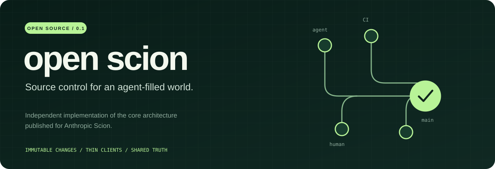
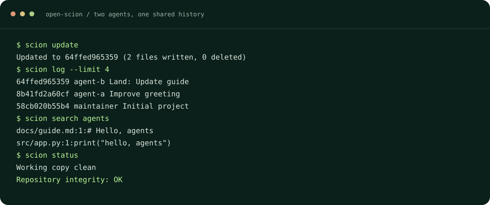
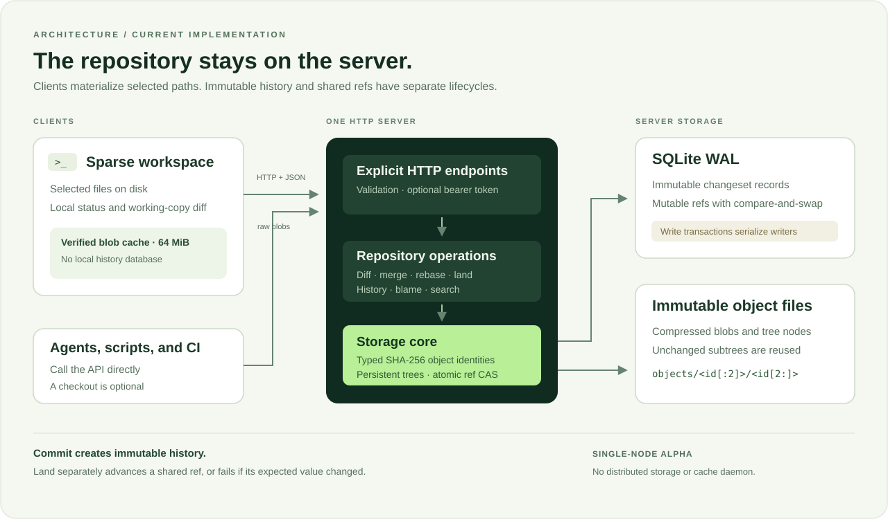

<p align="center"><strong>English</strong> · <a href="README.zh-CN.md">简体中文</a></p>

<p align="center"></p>

<p align="center">
  <a href="https://rizaust.github.io/open-scion/">Website</a> ·
  <a href="#quickstart">Get started</a> ·
  <a href="docs/ARCHITECTURE.md">Architecture</a> ·
  <a href="docs/API.md">HTTP API</a> ·
  <a href="CONTRIBUTING.md">Contributing</a>
</p>

<p align="center">
  <a href="https://github.com/rizaust/open-scion/actions/workflows/ci.yml"></a>
  
  
  <a href="LICENSE"></a>
</p>

# Open Scion

**An independent implementation of the core architecture published for Anthropic Scion.**

Open Scion is a server-first source control tool for developers, coding agents, and CI. The server owns immutable changesets and repository operations. A workspace holds the files you select and a bounded blob cache. Creating a changeset and advancing a shared branch are separate actions.

Built independently from the architectural ideas in Anthropic's October 13, 2026 article, [Redesigning source control at Anthropic](https://www.anthropic.com/engineering/redesigning-source-control), with its own codebase and HTTP protocol.

**Python 3.11+ · Zero third-party runtime dependencies · SQLite WAL · Content-addressed storage**

## Why Open Scion?

- **Keep workspaces small.** Materialize selected files or directories. Sparse commits preserve the paths you never checked out.
- **Share changes without moving a branch.** `commit` creates a server-side changeset; `land` separately advances a ref with compare-and-swap protection.
- **Ask the server.** Diff, history, merge, rebase, blame, and search are HTTP operations. A CI job can use the API without creating a working copy.
- **Reuse immutable content.** SHA-256 identities deduplicate blobs and persistent tree nodes. Clients verify downloaded content and retain a bounded local cache.
- **Recover and audit changes.** Working-copy journals support interrupted-update recovery, repository snapshots include verified objects, and shared-ref updates have a transactional audit trail.
- **Read the whole implementation.** The runtime uses Python's standard library. Git is needed only for the optional history importer.

## Quickstart

Install from source with Python 3.11 or newer:

```sh
git clone https://github.com/rizaust/open-scion.git
cd open-scion
python3 -m venv .venv
source .venv/bin/activate
python -m pip install .
```

The examples use a POSIX shell. On Windows, activate the environment with `.venv\Scripts\Activate.ps1` in PowerShell. CI is configured for Linux, macOS, and Windows with Python 3.11 and 3.13; check the [current workflow results](https://github.com/rizaust/open-scion/actions/workflows/ci.yml) for validation status.

In the first terminal, start a repository server and leave it running:

```sh
scion serve --data ../open-scion-data
```

In a second terminal, return to the cloned `open-scion` directory, activate the same environment, and create your first workspace:

```sh
source .venv/bin/activate
scion init ../open-scion-work --server http://127.0.0.1:7433
cd ../open-scion-work

mkdir -p src docs
printf 'print("Hello, Scion")\n' > src/hello.py
printf '# Project guide\n' > docs/guide.md

scion status
scion diff
scion commit -m "Add a greeting and project guide" --author Ada
scion land --ref main
scion log
```

`commit` uploads changed content and creates an immutable changeset on the server. It updates your workspace revision but leaves `main` unchanged. `land` moves `main` after checking its expected value; if histories diverged, the server attempts a merge. There is no separate push command.

Initialization requires an empty or nonexistent directory. Use a new directory if you repeat the example. To inspect the server without a workspace:

```sh
curl http://127.0.0.1:7433/health
curl http://127.0.0.1:7433/v1/refs
```

## A complete workflow



Run the [self-contained demo](examples/demo.py) from the cloned repository with the environment active:

```sh
python examples/demo.py
```

It starts a real local HTTP server, creates two sparse agent workspaces, commits divergent edits, lands both, checks repository integrity, and cleans up its temporary files. The commands above are also covered by subprocess integration tests.

All commands accept `--json`, before or after the subcommand. Successful results go to stdout; structured errors go to stderr with a nonzero exit status.

```sh
scion status --json
scion log --limit 5 --json
scion search "Hello" --rev main --json
```

## Work on just one directory

After the quickstart, create a second workspace containing only `src`:

```sh
scion init ../open-scion-src --server http://127.0.0.1:7433 --sparse src
cd ../open-scion-src

printf 'print("Hello from a sparse workspace")\n' > src/hello.py
scion commit -m "Update the greeting" --author Ada
scion land
scion search "Project guide" --prefix docs
```

`docs/guide.md` remains in the repository and is searchable on the server, even though it never appears in this workspace. Multiple prefixes are supported: `--sparse src docs`.

Create a `.scionignore` file to exclude untracked build output or local files:

```gitignore
__pycache__/
*.pyc
/build/
.env
```

Patterns use shell-style matching. Basename patterns match at any depth; patterns containing `/` are relative to the workspace root. A leading `/` anchors a pattern, and a trailing `/` excludes the matching subtree. Blank lines and `#` comments are ignored. Negation (`!`) is unsupported and rejected. Already tracked paths remain tracked. `.git` and `.scion` are always excluded.

## Architecture



A changeset contains its parents, a first-parent file delta, a root tree ID, and metadata. Updating the persistent Merkle tree copies affected directory nodes and reuses unchanged subtrees. Refs are mutable pointers kept separately from immutable history.

The client downloads selected file contents through HTTP and verifies their typed SHA-256 identities. Its 64 MiB blob cache can evict content without deleting history, because the server remains authoritative. No repository history database is copied to the workspace.

See [Architecture](docs/ARCHITECTURE.md) for storage layout, concurrency, merge semantics, working-copy protection, and implementation tradeoffs. See the [HTTP API](docs/API.md) for checkout-free reads and writes.

### Source layout

```text
open_scion/
├── cli/              # Parsing, command handlers, and output
│   └── commands/
├── client/           # HTTP transport and verified object API
├── graph/            # Generation-pruned traversal and metadata cache
├── importers/        # Git history adapters
├── operations/       # Inspection, text merging, and integration
├── server/           # Routes, validation, admission control, and telemetry
├── store/            # Objects, trees, changesets, refs, integrity, and snapshots
└── workspace/        # Scanning, cache, process locks, journals, and recovery
```

Package facades keep the public interfaces small while implementation modules own
specific persistence, protocol, and filesystem responsibilities.

## Commands

Run `scion COMMAND --help` for every flag. Workspace commands discover the workspace from the current directory or its parents.

| Task | Command |
| --- | --- |
| Start a repository | `scion serve --data DIRECTORY [--host HOST] [--port PORT]` |
| Create a workspace | `scion init DIRECTORY --server URL [--rev REV] [--sparse PREFIX ...]` |
| Inspect local edits | `scion status` · `scion diff` |
| Compare server revisions | `scion diff BASE TARGET [--prefix PATH]` |
| Create a changeset | `scion commit -m MESSAGE [--author NAME]` |
| Advance a shared ref | `scion land [REV] [--ref main] [--expected ID]` |
| Update a working copy | `scion update [REV]` |
| Merge histories | `scion merge THEIRS [--ours REV] [--base REV] -m MESSAGE` |
| Replay one changeset | `scion rebase ONTO [--revision REV]` |
| Inspect history | `scion log [REV] [--path PATH] [--limit N]` · `scion show [REV]` |
| Attribute or search text | `scion blame PATH [--rev REV]` · `scion search QUERY [--prefix PATH]` |
| List shared refs | `scion refs` |
| Import Git history | `scion import-git PATH --server URL [--ref main] [--revision HEAD]` |
| Verify server storage | `scion fsck --data DIRECTORY` |
| Create a repository snapshot | `scion backup --data DIRECTORY --output NEW_DIRECTORY` |
| Restore a verified snapshot | `scion restore SNAPSHOT --data NEW_DIRECTORY` |
| Inspect ref audit history | `scion ref-log [--name main] [--limit N]` |
| Recover an interrupted update | `scion recover` |

`land --expected none` requires a new ref. Without `--expected`, the client reads the current target and uses that snapshot for the compare-and-swap. Merge and rebase create a changeset and update the workspace; they leave shared refs unchanged.

Git import preserves the reachable commit DAG as Scion changesets, adds an `Imported-from-git` provenance trailer to each message, and returns the original and imported tip IDs. It requires an unused destination ref. IDs are different. Regular and executable files are supported; symlinks and submodules are rejected. Native operation has no Git dependency.

Workspaces use portable path names and reject reserved device names, colons, trailing dots/spaces, and case or Unicode collisions. On Windows, tracked executable modes are preserved in commits; newly created files default to non-executable.

## Working with confidence

The regression suite exercises immutable-object verification, competing ref updates, divergent merges, sparse commits, working-copy collision protection, cache corruption, and the CLI-to-HTTP workflow.

| Behavior | How it works |
| --- | --- |
| Shared ref updates | Exact atomic compare-and-swap; stale writers fail instead of replacing a newer target. |
| Conflicting merges | Return explicit conflict paths for resolution and keep the shared ref unchanged. |
| Working-copy updates | Refuse modified or deleted tracked files; protect colliding untracked and ignored files. Unrelated untracked files survive. |
| Content integrity | Verify typed SHA-256 identities on object reads and client downloads; `fsck` checks server consistency. |
| Sparse commits | Send deltas only for materialized paths; retain unseen paths from the parent. |

## Deployment

Run one repository service with `scion serve --data DIRECTORY`. Repository metadata lives in SQLite WAL, and immutable blobs and tree nodes live in compressed object files alongside it. SQLite transactions coordinate concurrent writers; each developer or agent uses a separate workspace.

The default listener is `127.0.0.1:7433`. To share a repository, set the same `SCION_TOKEN` environment variable for server and clients, and use an HTTPS reverse proxy or SSH tunnel for remote transport. A token grants repository-wide access, and binding beyond loopback requires one. The client reads the token from its environment, keeps it out of workspace metadata, and refuses HTTP redirects.

For consistency checks, run `scion fsck --data DIRECTORY`. See [storage and concurrency](docs/ARCHITECTURE.md#concurrency-and-refs), [working-copy updates](docs/ARCHITECTURE.md#update-protection), and the [HTTP transport reference](docs/API.md#transport-and-authentication) for operational details.

The service exposes `/ready` for repository readiness and authenticated
`/v1/metrics` counters. Configure `--max-workers`, `--max-inflight-bytes`, and
`--request-timeout` for request admission, then enable `--access-log` for JSON logs
correlated through `X-Request-ID`.

Use the supplied [Dockerfile](Dockerfile) and [Compose configuration](compose.yaml)
for a persistent container service. The [operations guide](docs/OPERATIONS.md)
covers deployment, live snapshots, verified restore, audit history, and workspace
recovery.

## Technical reference

| Area | Specification |
| --- | --- |
| Local blob cache | 64 MiB, content-verified, with least-recently-used eviction. |
| HTTP request body | Up to 16 MiB, including raw blob uploads. |
| Service admission | 32 concurrent workers and 64 MiB of admitted request bodies by default; configurable separately. |
| Graph queries | Generation pruning with a bounded 4,096-entry immutable metadata cache. |
| Native file modes | Regular files (`100644`) and executable files (`100755`); binary content is preserved. |
| Server text inspection | UTF-8 files up to 1 MiB and 20,000 lines; overlapping binary edits return conflicts. |
| History and search | First-parent log/blame and literal substring search over selected files. |
| Rebase | Replays one changeset's first-parent delta onto the chosen revision. |
| Update workflow | OS advisory lock, durable staged files and journal, atomic metadata commit, and offline recovery. |

The [architecture guide](docs/ARCHITECTURE.md) describes the algorithms and storage format. The [API reference](docs/API.md) covers request fields, response shapes, authentication, and error handling.

## Development

Development is organized into three [milestones](https://github.com/rizaust/open-scion/milestones):

| Milestone | Focus |
| --- | --- |
| [v0.2 — Reliable core](https://github.com/rizaust/open-scion/milestone/1) | Modular integration, durable workspace recovery, and repository backup operations. |
| [v0.3 — Team collaboration](https://github.com/rizaust/open-scion/milestone/2) | Scoped identities, idempotent requests, and protected-ref landing policies. |
| [v0.4 — Storage and query scale](https://github.com/rizaust/open-scion/milestone/3) | Storage backends, batched object transfer, indexes, garbage collection, and shared caches. |

Each issue describes its scope and acceptance criteria. Follow the milestones for
the current implementation and integration status.

```sh
python -m unittest discover -s tests -v
python -m compileall -q open_scion
```

Start with the [contributor guide](CONTRIBUTING.md), [architecture notes](docs/ARCHITECTURE.md), and [API reference](docs/API.md). Report reproducible bugs or discuss changes in [GitHub issues](https://github.com/rizaust/open-scion/issues).

Released under the [Apache License 2.0](LICENSE).
